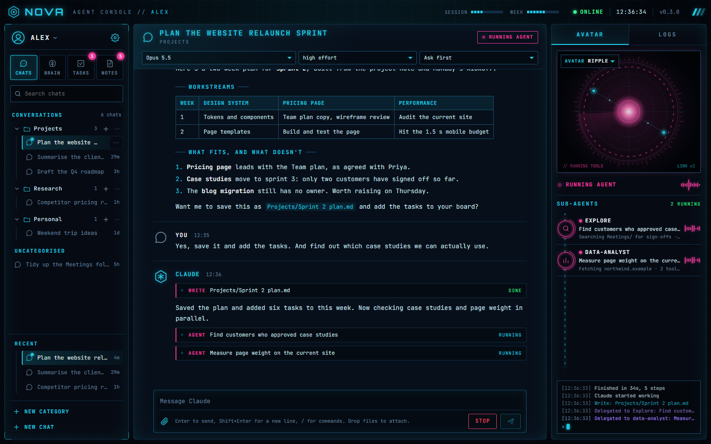
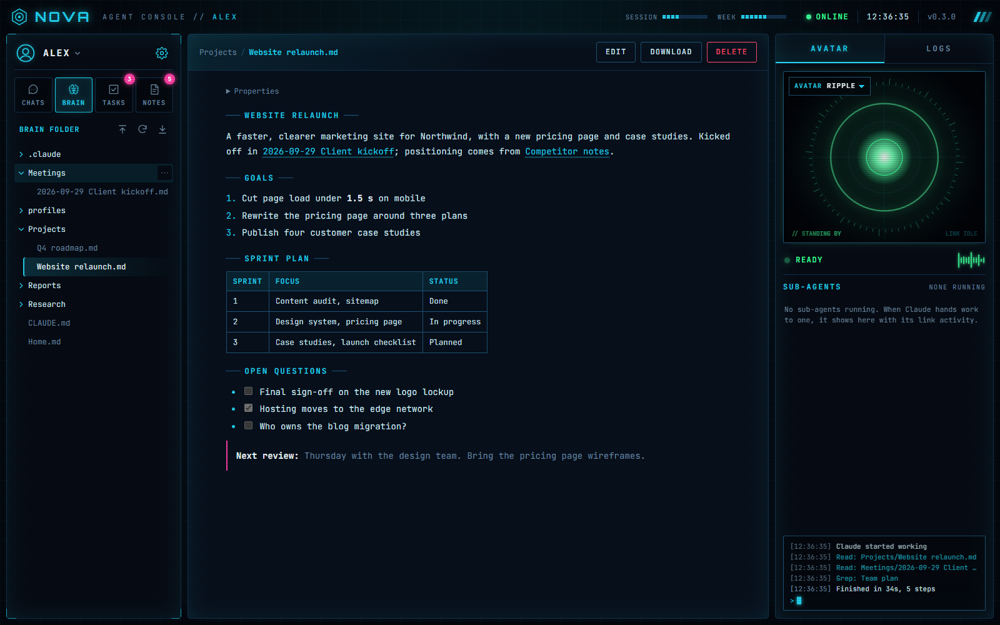
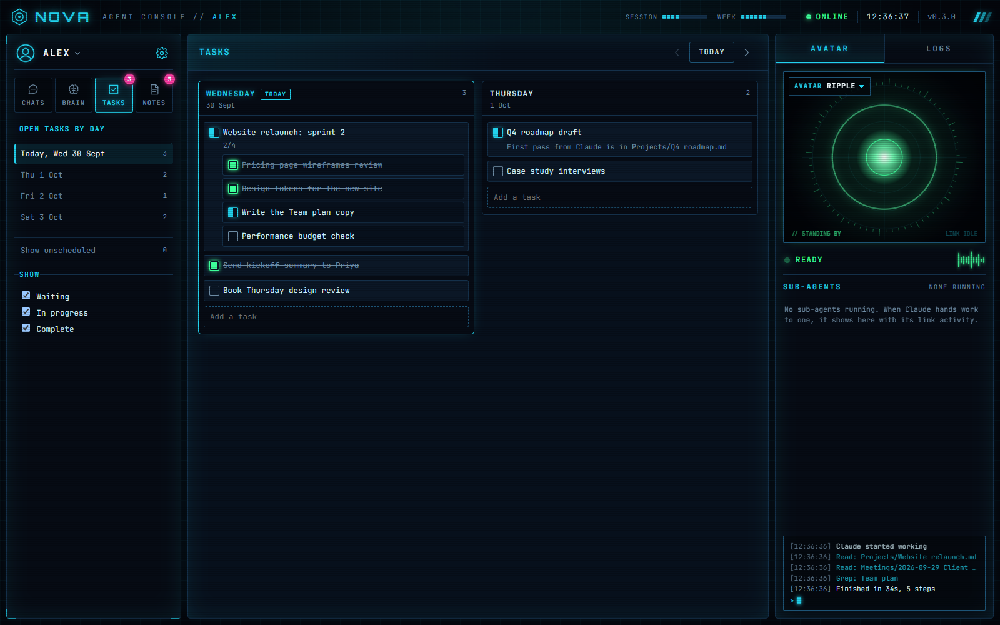
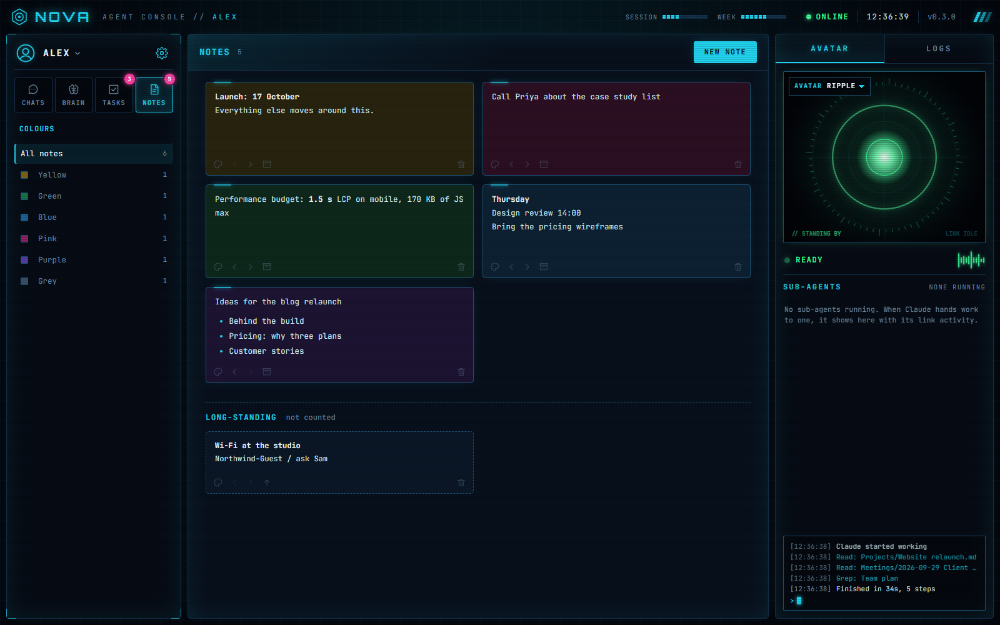
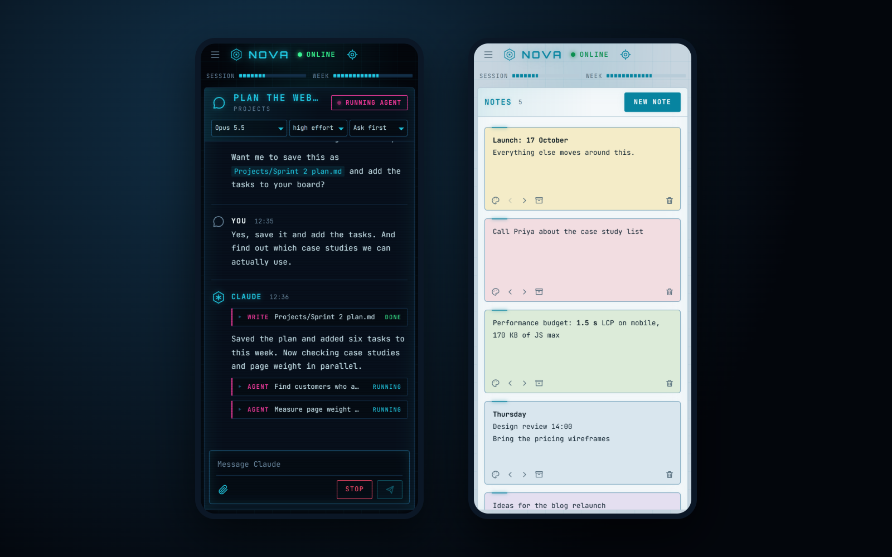

# Nova

**A home for Claude Code's agent, in your browser.** Nova wraps the [Claude Agent SDK](https://www.npmjs.com/package/@anthropic-ai/claude-agent-sdk) in a fast, installable web app built around a folder of markdown notes (your "brain"), so you get Claude Code's full power without living in a terminal or an IDE. It runs on your phone too.



Self-hosted and private: it runs on your own Windows machine or in a Proxmox container, signs in with your own Claude plan, and keeps everything in a folder you own.

Version 0.13.2 · Node 22.15+ · five dependencies · no build step

## Why Nova

- **Claude Code, not a chatbot.** Every chat is a real Claude Code session working in your notes: reading, searching, writing files, running tools and delegating to sub-agents. You watch it all happen and approve what matters.
- **Your notes are the context.** Point Nova at a folder of markdown (an Obsidian vault works). Nova reads it, follows its rules and skills, and keeps it up to date.
- **One place for the work around the chat.** Browse and edit the brain, plan your days and keep sticky notes, right beside the conversation.

## Features

### Home: your day at a glance

Nova opens on Home: the sidebar widens across the page, so your profile, home and settings buttons stay exactly where they always are, with the view tabs beside them and the cards below. It gathers what matters right now: chats waiting for your approval or answer, replies you haven't read, Nova's open questions; today's tasks, with the same square as the task board (click once to start one, again to finish it) and your active sticky notes; what Nova has been doing and what's next on its schedule; and your plan usage with reset times. Most things can be dealt with right there: start or finish a task, answer or dismiss a question, run a schedule now, or type into the Ask Nova box to start a chat. Get back to it with the home button beside your profile name or the Nova logo; a new chat left untouched for five minutes goes back to Home by itself. Each card shows only what the profile can use.

### A chat built for an agent

Replies stream in with markdown (code blocks copy with one click), collapsible thinking, and every tool call with its result. Sub-agents appear under the call that started them, and the presence panel shows what each one is doing, live. When Nova needs permission, you choose: allow once, for this chat, always, or deny. Pick the model, effort and permission mode per chat, attach files and images, and type `/` for your brain's own skills and commands. Edit any message you sent with the pencil beside it: Nova picks up from that point, and the old message and everything after it are replaced. Each chat keeps its own half-written message and attached files, so you can draft in one chat, look at another and come back to it where you left off.

You don't have to wait for Nova to finish. Send a message while it's replying and Nova reads it at its next step, so "actually, skip the tests" changes course partway through without losing the work so far. The message waits at the end of the chat until Nova reads it, then moves to that point. **Stop & send** (or Ctrl+Enter) stops what Nova is doing and sends your message straight away. Stop drops any message Nova hasn't read yet and puts it back in the box.

Long chats stay affordable. Claude keeps a chat's history cached for an hour, and reading a long history again after that uses a big share of your plan. So shortly before the hour is up, a long chat that has gone quiet writes itself a short summary, and when you come back the next day it carries on from that summary in a fresh session, under the same chat, with everything said so far still there to scroll back through. If the summary isn't enough, **Load full history** brings the whole conversation back. You can have Nova ask each time instead, or always load the full history (Settings, Claude). When the plan is nearly used up, long chats write their summaries straight away, so none is left stranded. Nova also compacts long chats earlier, while they're still cached, and trims very long command or file output.

### Your brain, in the browser

Read and edit the notes Nova works from. Markdown renders with `[[wiki links]]`, embeds, images and video; HTML reports render safely in a sandbox. Search the whole brain by file or folder name from the box above the tree. Upload files and folders, and if the brain is a git repository, every save is committed.



### Soul: how Nova comes across

The Soul sets Nova's character, style, tone and friendliness for every chat, in every profile: warm and chatty, crisp and businesslike, or whatever suits your household or team. Open it from the Core tab, the last of the tabs, which gathers the brain, the Soul, Heartbeat and Thought behind a switch at the top of its sidebar. An admin writes it in plain words, or markdown, and everyone with brain access can read it but not change it. New chats use it straight away, and open chats pick it up the next time they go quiet. It's sent with every chat, so it's kept short (6,000 characters at most), and it never changes Nova's name or what Nova is allowed to do. It's stored in the data folder as `soul.md`, outside the brain, so neither Nova nor a brain edit can change it.

### Heartbeat: work Nova does by itself

Ask Nova to check on something regularly ("every hour, look at what happened in Home Assistant and tell me if there's anything worth automating") and it sets up a schedule; or add one yourself in the Heartbeat pane of the Core tab. A schedule repeats every so many minutes or hours, runs at a time of day on the weekdays you pick, or runs just once at a date and time (all in the server's time). Nova uses a one-off when it needs to come back to something itself, such as "check at 2am whether the backup finished", rather than any hidden scheduler. Each run happens behind the scenes in a fresh session, so it doesn't fill your chats. Or a schedule can send its prompt into a chat of your choice instead, which is how Nova comes back to the conversation it scheduled from.

Runs behind the scenes are unattended and have full permission, as if every tool were always allowed, so **the schedule's prompt sets the limits**: say what Nova should do and what it mustn't touch. To keep frequent checks cheap, a schedule can name a **check script** (`.ps1`, `.sh`, `.py`, `.js`, `.bat` or `.cmd`) that runs first, without a model: a PowerShell script that lists new mail through Outlook's COM objects, say, or the last hour's Home Assistant events, filtered. If it prints nothing, the run is skipped and uses no tokens; whatever it prints is passed to Nova with the prompt. A check script that fails is noted in Thought. (Windows PowerShell reads a script saved without a byte-order mark as ANSI, so save scripts with accented text as UTF-8 with BOM.) Nova can't ask you anything mid-run; it records a question only when it can't go on without you. The Heartbeat pane lists every schedule with its next run, its prompt and its recent runs, and lets you run, stop, pause, edit or delete it, and read any run's transcript, without asking Nova. Profiles with edit access to Core manage their own schedules; runs pause while you're signed out of Claude or plan usage is high.

### Thought: Nova's train of thought

A shared timeline of what Nova has done, one short line each: the outcome of Heartbeat runs, tasks you confirm as finished, and project commits. Nova asks a question only when it can't go on without your decision; it waits here (and on the Core tab's badge, with a push notification) until you discuss it with Nova, which opens a new chat with the question ready, mark it answered or dismiss it. Everyone with access to Core sees the timeline; an entry's details and links show only for the profile it came from. Nova can read the timeline too, so it remembers what it did and what it asked.

### Talk to it

Dictate instead of typing: the microphone beside the message box, and on any sticky note you're editing, turns speech into text at the cursor. It uses the browser's own speech recognition (Edge and Chrome send the audio to Microsoft or Google to turn it into text; Safari mostly works; Firefox has none), and needs https or this computer, so it's not offered over a plain-http network address.

Nova can also read its answers aloud, keeping them short and conversational while it does, so it works hands-free on a phone. It's off until you choose how in Settings, under Voice, on each device: **This browser's voices** (quality varies a lot: Edge's are natural, an iPhone only offers web pages its basic voices) or **Piper**, which sounds the same everywhere. Then the speaker button beside Send turns spoken replies on and off.

Piper isn't bundled. If you already run [Piper](https://github.com/OHF-Voice/piper1-gpl), an admin enters its address once under Voice: Piper's HTTP server (`http://host:5000`) or Wyoming, such as Home Assistant's Piper add-on with its port published (`tcp://host:10200`). Nova relays text to it, and the browser's voice stands in for anything Piper can't read.

### Tasks and notes, beside the chat

A day-by-day task board with subtasks and states, and a wall of coloured sticky notes. Drag whole cards to reorder or nest them, with the mouse or a long press on a touch screen. Both are counted on their tabs, so you can see what's left today at a glance. Show a sticky note to everyone (a shopping list, a household board) and it appears for every profile, where anyone can edit or delete it; only you can take it back.

Nova can use them too. Ask in any chat ("plan my week from the sprint note", "tick off what we just finished", "make a sticky note of that") and it reads and changes your tasks and notes directly. Reading never asks; adding, changing and deleting ask for your approval like any other tool, naming the task or note, unless you've said always allow. **Hand to Nova** in a task's menu starts a new chat with the task and its subtasks, ready to send.

<p>
  
  
</p>

### Apps Nova builds for you

Ask Nova for a small web app (a budget planner, a dashboard, a quiz) and it builds one in Nova's apps folder, one folder per app. The **Apps** tab lists them, in categories you can drag them between. Pick one to browse and edit its files, with syntax colouring for HTML, CSS, JavaScript, JSON, Python and Markdown, then press **Run app** to use it: it shows as a plain browser page, true to its source. The copy button beside it copies its address, `/apps/<name>/`, to open in a browser of its own (where you sign in to Nova as usual). Nova links to an app with `nova://apps/<name>`, so a link in a chat reply or a brain note opens the app straight away.

Apps run in a sandbox: they can't see Nova's sign-in or call Nova as you, and each can only reach its own files. An app can also have a backend: `backend.js`, a JavaScript module that Nova's own Node.js runs for each request the app sends to its `api/` address, so there's nothing extra to install. It only runs after an admin turns it on for that app. Each request gets a fresh, locked-down Node process (Node's permission model, on Windows and Linux alike): it can read only its own app's folder, write only to the app's `data` folder, can't start other programs, and has a clean environment, a memory cap and a time limit. It can still reach the internet, so only turn on backends you trust.

An app can also work on files in the brain, such as a YAML file where Nova keeps a list of things, so the app becomes a friendly form for editing it while the file stays where Nova reads it. The app names the files and folders it needs in its `app.json` (`"brain": { "Inventory/items.yaml": "write", "Recipes/": "read" }`), and an admin allows them once from a notice in the Apps view; anything added later waits for the admin again. The app then reads and saves them through its own address (`brain/<path>`), always as the person using it: it can never do more than they could in the Brain view, saves check the file hasn't changed meanwhile, and changes are committed like any other brain edit. A backend gets the same files to read and write directly, within the same limits, and its changes are committed after each request. Who can see and change apps is set per profile, like the other views (users have no access until an admin gives it).

### Find anything

Press **Ctrl+K** (**⌘K** on a Mac), or the search button in the header on a phone, and one box searches everything: chats by title, brain files by name and by the words inside them, tasks, sticky notes (shared ones too), apps and skills. Results are grouped and each opens where it lives: the chat, the file, the task on its day, the note on the board, the app running, or a new chat with the skill ready to run.

### Wherever you are

Install Nova as an app on desktop or phone. It's fully responsive (on a phone, swipe in from either edge for the sidebar or the avatar panel, and tap the Nova logo to get back to Home), dark or light, and keeps your chats in sync across every device. Run it remotely behind Cloudflare to reach it from anywhere: a heartbeat keeps the connection open through the tunnel, a phone waking up reconnects at once without losing your place in the chat, and nothing you type is lost to a dropped connection (a message that never arrived comes back to the box).



### Also included

- Several profiles (work, home, and so on), each with its own chats, notes folder, tasks and notes; admin and user roles, with per-view access (users see a simpler chat, without the file and shell tool steps)
- Profile switcher with pictures and a 4-digit PIN
- Chat categories with drag and drop, search and a Recent list
- Sign in to Claude from Settings with a Claude subscription or an Anthropic Console account; Nova never handles a token
- Plan usage meters with reset times
- Remembered approvals and extra folders per profile
- Activity log and an animated avatar that follows what Nova is doing
- Notifications and an app badge when Nova finishes or needs you, including push notifications that arrive with Nova closed (Edge, Chrome, Firefox, and the iPhone and iPad home-screen app), only for the profile signed in on that device
- One-click updates for Nova and the Agent SDK, tested before they install, with automatic rollback
- The brain's `CLAUDE.md` and `.claude/` rules, skills and agents load into every chat, just as in Claude Code

## Get started

You'll need a Claude subscription or an Anthropic Console account for Claude itself.

### On Windows

Nova runs quietly in the background as you, from sign-in. No admin rights needed.

1. Install [Node.js](https://nodejs.org) (24 LTS recommended) and [Git](https://git-scm.com).
2. Download Nova and its packages:
   ```powershell
   git clone https://github.com/karlfoster87/nova-app C:\Nova
   cd C:\Nova
   npm install
   ```
3. Create your profile (you'll be asked for a password of 12+ characters):
   ```powershell
   npm run add-profile -- yourname --admin
   ```
4. Tell Nova where your notes are: in `data\config.json`, set `"paths": { "brainDir": "C:/Notes/Brain" }`. You can change it later in Settings.
5. Start Nova, now and at every sign-in:
   ```powershell
   powershell -ExecutionPolicy Bypass -File scripts\install-windows.ps1
   ```
6. Open **http://127.0.0.1:8484** in Edge, sign in, and choose **Apps → Install this site as an app**.
7. In Nova, go to **Settings → Claude → Sign in with Claude**, open the link it shows, approve, and paste the code back.

To stop Nova, run the same script with `-Stop`; `-Uninstall` removes the autostart. Logs are in `data\logs\nova.log`.

### In a Proxmox container (always on, reachable from anywhere)

1. Create an unprivileged Debian 12 container (4 GB memory is plenty) and bind-mount your notes folder into it, for example at `/mnt/brain` (in an unprivileged container, the files must be owned by the mapped UID of the container's `nova` user, 100000 plus `id -u nova`).
2. Inside the container, as root:
   ```bash
   apt-get update && apt-get install -y curl
   curl -fsSL https://raw.githubusercontent.com/karlfoster87/nova-app/main/scripts/setup-lxc.sh | bash -s -- --brain /mnt/brain
   nova add-profile yourname --admin
   ```
   This installs Node, creates a locked-down `nova` user and starts Nova as a service. Run it again any time to repair the install; your data is never touched.
3. Put [Cloudflare Tunnel](https://developers.cloudflare.com/cloudflare-one/connections/connect-networks/) in front of `http://127.0.0.1:8484`, with Cloudflare Access (a long session, around a month, suits the installed app).
4. Open Nova, sign in, and connect Claude from **Settings → Claude**.

For a tight setup, limit the container's outbound traffic to Anthropic and Claude, GitHub, npm, NodeSource, the Debian mirrors, Cloudflare, your file shares and, for push notifications, the browsers' push services (`*.notify.windows.com` for Edge, `*.push.apple.com` for iPhone and iPad, `fcm.googleapis.com` for Chrome, `*.push.services.mozilla.com` for Firefox). The `nova` command also does `logs`, `status`, `restart`, and `claude-login` for terminal sign-in.

## Updates

**Settings → Updates** checks this repository and npm once a day and offers **Update and restart** when something's new. Each update is downloaded and tested first, and Nova rolls back by itself if anything goes wrong. It never overwrites a copy with changes of its own.

## Good to know

- **Your data** lives in `data/` (or `/opt/nova/data`): `config.json`, the database, Nova's own Claude sign-in and chat transcripts, attachments and logs. Keep it private, backups included.
- **Settings you may want** in `config.json`: `server.port` (8484), `server.mode` (`remote` behind a tunnel), `paths.brainDir`, `chats.idleMinutes` (30), `chats.coldResume` (`fresh`, `ask` or `full`), `chats.handoffMinutes` (50), `chats.handoffMinTokens` (30000), `chats.handoffAtUsage` (85%), `chats.autoCompactPercent` (60), `chats.maxToolResultChars` (20000), `updates.checkHours` (24, or 0 to stop checking), `paths.appsDir` (`data/apps`), for app backends `apps.timeoutSec` (15) and `apps.memoryMB` (256), and for Heartbeat `heartbeat.enabled` (true), `heartbeat.maxConcurrent` (2 runs at once), `heartbeat.minMinutes` (5), `heartbeat.maxRunMinutes` (15), `heartbeat.pauseAtUsage` (90%), `heartbeat.keepRunsDays` (30) and `thought.keepDays` (180).
- **Security:** every request is checked against the signed-in profile, passwords and PINs are hashed with scrypt, sessions are HttpOnly and SameSite=Strict, a strict Content Security Policy is in place, and chat output is sanitised before it's shown. Nova's chats act as the user running Nova, so in a container, the container is the boundary.

## Under the hood

Node.js with native ES modules in the browser: no framework, no bundler, and only five dependencies (the Agent SDK, `ws`, `marked`, `dompurify`, and `zod` for the schemas of Nova's own task and note tools, which the SDK already needs). Data is in SQLite through `node:sqlite`.

```
server/    the Node server: routes/, ws.js, and a folder per area (chat, brain, apps, accounts, claude, views, updates, voice)
public/    the browser app: js/ (a folder per area) and css/ (one stylesheet per area)
scripts/   install scripts, profile and sign-in tools, checks and smoke tests
```

| Command | |
|---|---|
| `npm start` | Run in the foreground |
| `npm run add-profile -- <name> [--admin]` | Add a profile or reset a password |
| `npm run claude-login` | Sign in to Claude from the terminal |
| `npm run check` | Syntax and import check |
| `npm run smoke` | End-to-end test on throwaway data (sends no prompts) |
